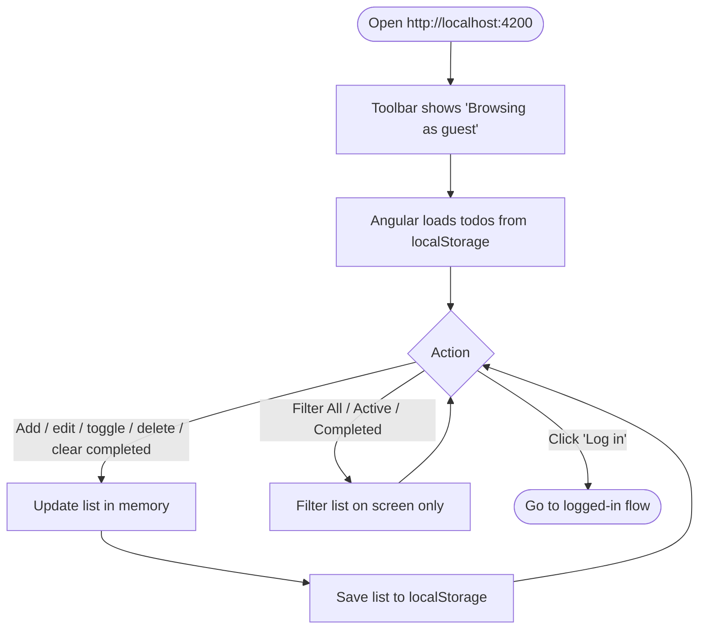
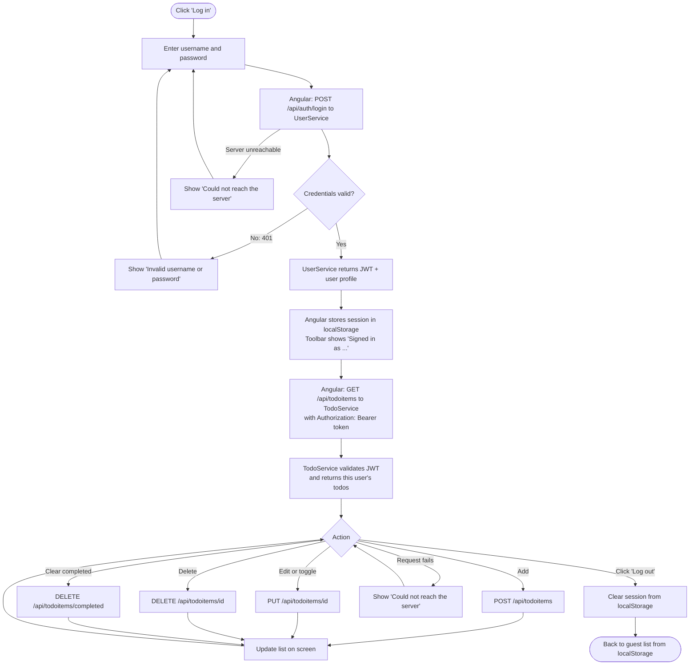
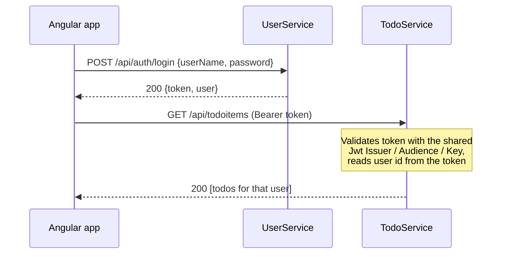

# TODO-List
TODO List App with Angular FE and .NET BE for Global360 Coding Assessment

## Applications

| App | Folder | URL | Purpose |
|-----|--------|-----|---------|
| **Angular app** | `TODO-Angular` | http://localhost:4200 | The UI. Guests keep todos in the browser (`localStorage`); signed-in users read and write their todos through TodoService. |
| **UserService** | `TODO-UserService` | http://localhost:5123 | Accounts and login. `POST /api/users` creates a user; `POST /api/auth/login` checks the password and returns a signed JWT plus the user's profile. |
| **TodoService** | `TODO-TodoService` | http://localhost:5066 | Todo items for signed-in users. Every `/api/todoitems` endpoint requires a JWT issued by UserService and only returns or changes items owned by the user in the token. |

Both services use EF Core in-memory databases, so data resets every time a service restarts. UserService seeds a demo account (TodoService seeds two todos for it):

- **Username:** `demo`
- **Password:** `Demo123!`

### UserService endpoints

| Method | Route | Description | Responses |
|--------|-------|-------------|-----------|
| POST | `/api/users` | Create a user | `201` user profile, `400` validation errors, `409` username or email already taken |
| POST | `/api/auth/login` | Sign in | `200` JWT + user profile, `401` invalid username or password |

### TodoService endpoints

All routes require `Authorization: Bearer <token>`. A todo that belongs to another user is treated as not found.

| Method | Route | Description | Responses |
|--------|-------|-------------|-----------|
| GET | `/api/todoitems` | List the current user's todos | `200` |
| GET | `/api/todoitems/{id}` | Get one todo | `200`, `404` |
| POST | `/api/todoitems` | Create a todo | `201`, `400` |
| PUT | `/api/todoitems/{id}` | Update title / completed state | `200`, `400`, `404` |
| DELETE | `/api/todoitems/{id}` | Delete a todo | `200`, `404` |
| DELETE | `/api/todoitems/completed` | Delete all completed todos | `200` |

Sample requests for both services are in the `.http` files in each service folder.

## Running locally

### Prerequisites

- [.NET 10 SDK](https://dotnet.microsoft.com/download)
- [Node.js](https://nodejs.org/) (LTS) and npm
- Windows PowerShell (for the start script)

### Quick start

From the `TODO-List` folder run:

```powershell
.\start-all.ps1
```

The script:

1. Runs `dotnet restore` for UserService and TodoService.
2. Runs `npm install` for the Angular app if `node_modules` is missing.
   If a restore or install fails, the script stops with an error before starting anything.
3. Starts each app in its own PowerShell window (skipping any that are already running).
4. Waits up to 3 minutes for the Angular dev server and opens http://localhost:4200 in your browser.

Close an app's window (or press Ctrl+C in it) to stop that app.

> If PowerShell blocks the script, run it with
> `powershell -ExecutionPolicy Bypass -File .\start-all.ps1`.

### Manual start

Run each in a separate terminal:

```powershell
# UserService
cd TODO-UserService
dotnet run --launch-profile http

# TodoService
cd TODO-TodoService
dotnet run --launch-profile http

# Angular app
cd TODO-Angular
npm install
npm start
```

Then open http://localhost:4200.

The Angular app reads the service URLs from `TODO-Angular/public/config.json`. Update that file if you change the service ports.

### Configuration

- **Service URLs** (Angular): `TODO-Angular/public/config.json`.
- **JWT settings**: the `Jwt` section (Issuer / Audience / Key) in each service's `appsettings.json`. The two services must use the same values.
- **CORS**: both services allow `http://localhost:4200` and `http://localhost:4201`, set in each service's `Program.cs`.

> These values are kept in the codebase to make the assessment easy to run. In a real deployment the JWT key should come from a secret store such as Azure Key Vault, and the allowed origins from configuration.

### Running the tests

Backend (UserService unit and integration tests):

```powershell
dotnet test TODO_UserServiceTest.Unit
dotnet test TODO_UserServiceTest.Integration
```

Frontend (Angular CLI specs):

```powershell
cd TODO-Angular
npm test
```

### Test coverage and what's missing

The UserService is the only app with a real test suite. TodoService has no test project, and the Angular specs are just the "should create" checks the Angular CLI generated.

**Why UserService was tested first.** For a time-boxed assessment I put the testing effort where a bug would do the most damage. UserService owns the security-critical logic: creating accounts, hashing and checking passwords, and issuing JWTs. A bug there either locks users out or lets the wrong person in. Its two test projects show the approach for both levels:

- **Unit tests** (`TODO_UserServiceTest.Unit`) call the endpoint handlers directly against an in-memory database.
- **Integration tests** (`TODO_UserServiceTest.Integration`) host the whole service in memory with `WebApplicationFactory<Program>` and test it over HTTP.

**TodoService.** It uses the same vertical-slice layout and the same in-memory EF Core setup as UserService, so its tests would follow the same two patterns. `Program` is already exposed for `WebApplicationFactory`. The tests that matter most:

- Each endpoint returns `401` without a valid token.
- A user can't read, update or delete another user's todo. Each of these should return `404`.
- Validation: an empty or whitespace title returns `400`.
- `DELETE /api/todoitems/completed` removes only the caller's completed items.

**Angular.** The frontend was the lowest priority for tests, because the server enforces the auth and data-ownership rules, not the UI. The specs worth adding next:

- `AuthService`: stores the session in `localStorage`, restores it after a refresh, and clears it on logout.
- `TodoService` (Angular): uses `localStorage` for guests and calls the HTTP API with a Bearer token when signed in. These would use `HttpTestingController`.
- `Login` component: shows the right message for a `401`, an unreachable server (status `0`), and any other error.
- `TodoList` component: add, edit, toggle, delete, clear completed, and the All / Active / Completed filters.

## User flows

### Guest user

Guests can use the full todo list without an account. Nothing is sent to the backend; todos are saved in the browser's `localStorage` and stay on that browser only.



### Logged-in user

Signing in swaps the list to the user's server-side todos. The JWT from UserService is kept in `localStorage`, so the session survives a page refresh, and sent as a `Bearer` token on every TodoService call.



### How the services trust each other



TodoService never calls UserService. Both services share the same `Jwt` settings in `appsettings.json`, so TodoService can check a token's signature by itself and take the user id from it.

Guest todos and account todos are kept separate: logging in doesn't upload the guest list, and logging out brings the guest list back.
