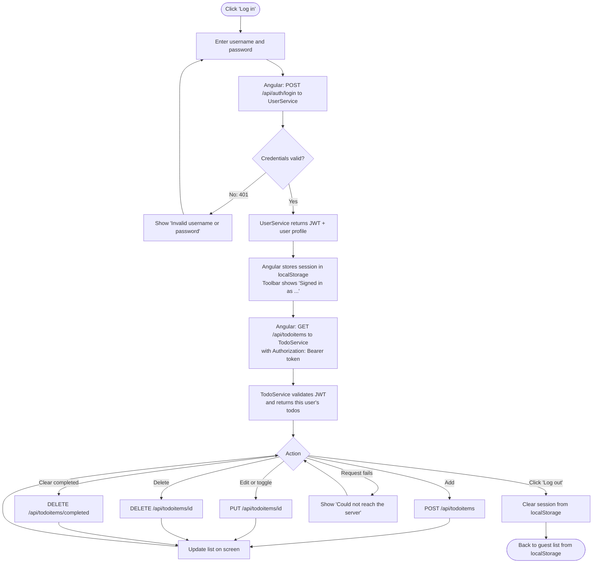
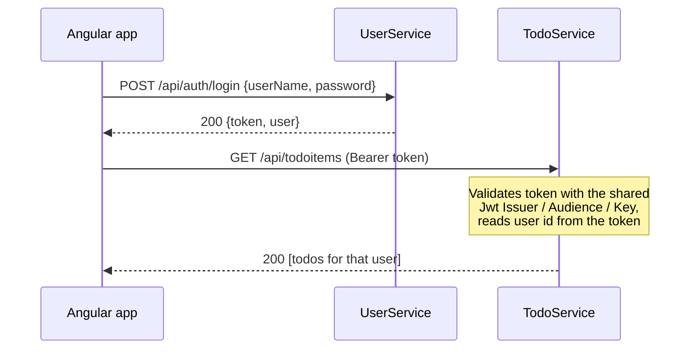

# TODO-List
TODO List App with Angular FE and .NET BE for Global360 Coding Assessment

## Applications

| App | Folder | URL | Purpose |
|-----|--------|-----|---------|
| **Angular app** | `TODO-Angular` | http://localhost:4200 | The UI. Guests keep todos in the browser (`localStorage`); signed-in users read and write their todos through TodoService. |
| **UserService** | `TODO-UserService` | http://localhost:5123 | Accounts and login. `POST /api/users` creates a user; `POST /api/auth/login` checks the password and returns a signed JWT plus the user's profile. |
| **TodoService** | `TODO-TodoService` | http://localhost:5066 | Todo items for signed-in users. Every `/api/todoitems` endpoint requires a JWT issued by UserService and only returns or changes items owned by the user in the token. |

Both services use EF Core in-memory databases, so data resets every time a service restarts. UserService seeds a demo account (TodoService seeds two todos for it):

- **Username:** `demo`
- **Password:** `Demo123!`

### TodoService endpoints

| Method | Route | Description |
|--------|-------|-------------|
| GET | `/api/todoitems` | List the current user's todos |
| GET | `/api/todoitems/{id}` | Get one todo |
| POST | `/api/todoitems` | Create a todo |
| PUT | `/api/todoitems/{id}` | Update title / completed state |
| DELETE | `/api/todoitems/{id}` | Delete a todo |
| DELETE | `/api/todoitems/completed` | Delete all completed todos |

Sample requests for both services are in the `.http` files in each service folder.

## Running locally

### Prerequisites

- [.NET 10 SDK](https://dotnet.microsoft.com/download)
- [Node.js](https://nodejs.org/) (LTS) and npm
- Windows PowerShell (for the start script)

### Quick start

From the `TODO-List` folder run:

```powershell
.\start-all.ps1
```

The script:

1. Runs `dotnet restore` for UserService and TodoService.
2. Runs `npm install` for the Angular app if `node_modules` is missing.
3. Starts each app in its own PowerShell window (skipping any that are already running).
4. Waits for the Angular dev server and opens http://localhost:4200 in your browser.

Close an app's window (or press Ctrl+C in it) to stop that app.

> If PowerShell blocks the script, run it with
> `powershell -ExecutionPolicy Bypass -File .\start-all.ps1`.

### Manual start

Run each in a separate terminal:

```powershell
# UserService
cd TODO-UserService
dotnet run --launch-profile http

# TodoService
cd TODO-TodoService
dotnet run --launch-profile http

# Angular app
cd TODO-Angular
npm install
npm start
```

Then open http://localhost:4200.

The Angular app reads the service URLs from `TODO-Angular/public/config.json`. Update that file if you change the service ports.

### Running the tests

```powershell
dotnet test TODO_UserServiceTest.Unit
dotnet test TODO_UserServiceTest.Integration
```

## User flows

### Guest user

Guests can use the full todo list without an account. Nothing is sent to the backend; todos are saved in the browser's `localStorage` and stay on that browser only.


### Logged-in user

Signing in swaps the list to the user's server-side todos. The JWT from UserService is kept in `localStorage`, so the session survives a page refresh, and sent as a `Bearer` token on every TodoService call.



### How the services trust each other



TodoService never calls UserService. Both services share the same `Jwt` settings in `appsettings.json`, so TodoService can check a token's signature by itself and take the user id from it.

Guest todos and account todos are kept separate: logging in doesn't upload the guest list, and logging out brings the guest list back.
